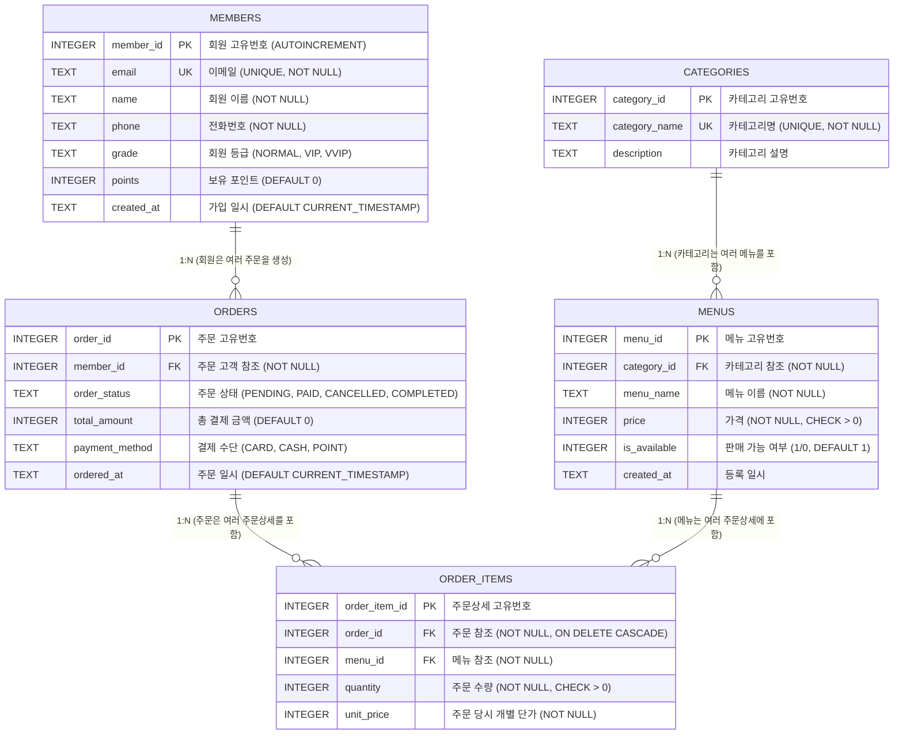

# ☕ 스마트 카페 주문 시스템 (Cafe Order DB) 설계 및 구현 계획서 (PLAN.md)

> **프로젝트명**: 스마트 카페 주문 및 고객 관리 관계형 데이터베이스 시스템  
> **기준 프레임워크**: `PROJECT_WORKFLOW_PROMPT_TEMPLATE.md` (7단계 마스터 프로세스)  
> **과제 원본**: `코디세이 b6-1.md`  
> **실행 환경**: Zero-Dependency Python 3.10+ (`sqlite3` 내장 엔진 및 표준 ANSI SQL 호환)

---

## 1. 프로젝트 개요 및 도메인 모델링 목적

### 1.1 도메인 선정: "스마트 카페 주문 & 회원 리워드 시스템"
- **선정 이유**: 
  - 카페 주문 시스템은 실무에서 가장 빈번하게 마주치는 **다대다(N:M) 주문-상품 관계를 중간 테이블(주문 상세)로 1:N 2개로 정규화**하는 전형적인 구조를 가집니다.
  - 회원(Member), 메뉴 카테고리(Category), 메뉴(Menu), 주문(Order), 주문 상세(OrderItem)의 5개 테이블로 구성되어 요구사항(최소 4개 테이블, 1:N 관계 최소 2개 이상)을 초과 달성합니다.
  - 실무 요구(인기 메뉴 집계, 회원별 누적 결제액 랭킹, 미주문 회원 발굴, 재고/단가 변동 대응 등)를 15개 필수 SQL 쿼리로 명확하게 실습할 수 있습니다.

### 1.2 핵심 제약 사항 준수 계획
1. **백엔드 프레임워크 배제**: Spring/Django 없이 순수 SQL 스크립트와 검증/학습 스크립트만으로 데이터 무결성을 입증합니다.
2. **Zero-Dependency DB**: 표준 Python 내장 `sqlite3`를 사용하여 별도 서버 설치 없이 누구나 즉시 실행 및 검증 가능하도록 구현합니다. (MySQL/PostgreSQL 표준 SQL 문법 호환성 유지)
3. **참조 무결성 강제**: SQLite 특성상 기본 비활성화되어 있는 외래키 제약(`PRAGMA foreign_keys = ON;`)을 최우선 적용하여 부모 없는 자식 데이터 삽입을 원천 차단합니다.

---

## 2. 테이블 스키마 상세 설계 (5개 테이블)



### 2.1 요구사항 충족 매핑
| 요구사항 | 구현 계획 | 충족 검증 방법 |
| :--- | :--- | :--- |
| **최소 4개 테이블** | 총 5개 테이블 (`members`, `categories`, `menus`, `orders`, `order_items`) | `sqlite_master` 메타 테이블 조회 |
| **각 테이블 PK** | 5개 테이블 전원 `PRIMARY KEY` 지정 | `PRAGMA table_info()` 검증 |
| **1:N 관계 최소 2개** | 총 4개 관계 지정 (`categories->menus`, `members->orders`, `orders->order_items`, `menus->order_items`) | 외래키 참조 검증 |
| **NOT NULL 제약** | `email`, `name`, `menu_name`, `price`, `quantity` 등 필수 컬럼 적용 | `NOT NULL` 위반 INSERT 테스트 |
| **UNIQUE 제약** | `members.email`, `categories.category_name` 적용 | 중복 데이터 삽입 차단 테스트 |
| **FK 실제 동작** | `PRAGMA foreign_keys = ON;` 활성화 및 존재하지 않는 부모 ID 참조 차단 | `IntegrityError` 발생 검증 |
| **테이블당 최소 10행** | 5개 테이블 각 10~15행 (총 60행 이상) 샘플 데이터 입력 | `COUNT(*)` 10행 이상 확인 |

---

## 3. 핵심 SQL 쿼리 15개 명세

| 번호 | 범주 | 쿼리 목적 및 내용 | 핵심 키워드 |
| :---: | :--- | :--- | :--- |
| **Q01** | 기본 조회 1 | 판매 중인 메뉴 목록을 가격 내림차순으로 상위 5개 조회 | `WHERE`, `ORDER BY`, `LIMIT` |
| **Q02** | 기본 조회 2 | 2026년에 가입한 VIP 이상 등급 회원의 이름, 이메일, 포인트 조회 | `WHERE`, `AND`, `IN` |
| **Q03** | 기본 조회 3 | 결제 완료(`PAID`, `COMPLETED`)된 주문 중 결제 금액이 15,000원 이상인 주문 조회 | `WHERE`, `BETWEEN / >=`, `ORDER BY` |
| **Q04** | 기본 조회 4 | 카카오페이 또는 카드 결제 건 중 최근 주문 5건 페이징 조회 | `WHERE`, `ORDER BY DESC`, `LIMIT`, `OFFSET` |
| **Q05** | 조인 1 (INNER) | 주문별 주문자 정보(이름, 등급)와 주문 금액, 주문 일시 조회 | `INNER JOIN members` |
| **Q06** | 조인 2 (INNER) | 주문 상세 내역: 주문번호, 메뉴명, 카테고리명, 수량, 주문금액 (3개 테이블 조인) | `INNER JOIN menus`, `INNER JOIN categories` |
| **Q07** | 조인 3 (LEFT) | 한 번도 주문하지 않은 회원(신규 또는 휴면 고객) 발굴 조회 | `LEFT JOIN orders WHERE order_id IS NULL` |
| **Q08** | 조인 4 (LEFT) | 모든 메뉴별 누적 판매 수량 조회 (단 한 번도 주문되지 않은 메뉴도 0개로 표시) | `LEFT JOIN order_items`, `COALESCE` |
| **Q09** | 집계 1 (GROUP BY) | 카테고리별 등록 메뉴 수, 평균 가격, 최고 가격 집계 | `COUNT`, `AVG`, `MAX`, `GROUP BY` |
| **Q10** | 집계 2 (GROUP BY) | 회원별 총 주문 횟수 및 누적 주문 금액 합계, VIP 판정 기준 랭킹 조회 | `COUNT`, `SUM`, `GROUP BY`, `ORDER BY DESC` |
| **Q11** | 집계 3 (HAVING) | 주문 건수가 2회 이상 발생한 단골 고객 및 총 주문액 필터링 | `GROUP BY`, `HAVING COUNT(*) >= 2` |
| **Q12** | 서브쿼리 1 | 전체 음료 메뉴의 평균 가격보다 비싼 프리미엄 메뉴 목록 조회 | `WHERE price > (SELECT AVG(price) FROM ...)` |
| **Q13** | 데이터 수정 (UPDATE) | 누적 주문 금액 30,000원 이상인 일반 회원의 등급을 'VIP'로 승급하고 포인트 2,000점 부여 | `UPDATE members SET ... WHERE member_id IN (...)` |
| **Q14** | 데이터 삭제 (DELETE) | 취소(`CANCELLED`)된 주문 중 주문 상세가 없는 주문 건 삭제 (참조 무결성 유지) | `DELETE FROM orders WHERE order_status = 'CANCELLED'` |
| **Q15** | 인덱스 (INDEX) | 주문 검색 성능 향상을 위한 `idx_orders_member_date` 복합 인덱스 생성 및 실행 계획 분석 | `CREATE INDEX`, `EXPLAIN QUERY PLAN` |

---

## 4. 디렉토리 구조 및 단계별 산출물

```text
codyssey-b6-01/
├── sql/
│   ├── 01_schema.sql                  # [Step 2] DDL: 테이블 5개 정의, 제약조건, 외래키 활성화
│   ├── 02_sample_data.sql              # [Step 2] DML: 각 테이블 10행 이상 샘플 데이터 INSERT
│   └── 03_queries.sql                  # [Step 2] DQL/DML: 15개 핵심 쿼리 및 실행 목적 기술
├── tests/
│   └── test_database.py               # [Step 3] 0.05초 초고속 단위 테스트 (무결성, FK, 쿼리 전수 검증)
├── scripts/
│   ├── generate_diagrams_matplotlib.py # [Step 4] Matplotlib 고해상도 아키텍처 다이어그램 4종 생성기
│   ├── verify_requirements.py         # [Step 5] 평가자용 원클릭 시각적 검증 러너 (JSON 및 컬러 터미널)
│   └── build_notebooklm_source.py     # [Step 6] 순수 소스 단일 텍스트(NOTEBOOKLM_FULL_SOURCE.txt) 빌더
├── diagrams/                          # [Step 4] Matplotlib 생성 고해상도 PNG 이미지 저장소
│   ├── 01_erd_diagram.png
│   ├── 02_one_to_many_relation.png
│   ├── 03_sql_join_principles.png
│   └── 04_query_pipeline_flow.png
├── captures/                          # [Step 5] 15개 쿼리 실행 결과 캡처 텍스트 및 마크다운
│   └── query_execution_results.md
├── PLAN.md                            # [Step 1] 본 계획서
├── 스터디.md                           # [Step 4] 과제 전문 수록, 요구사항 대조, 주니어 일상 비유
├── REPORT.md                          # [Step 5] 엔지니어링 세부 리포트 (벤치마크, 엣지케이스, 성능)
├── NOTEBOOKLM_GUIDE.md                # [Step 6] NotebookLM 소스 목록 최상단 명시, 팟캐스트 기획
├── NOTEBOOKLM_FULL_SOURCE.txt         # [Step 6] 단일화된 순수 소스 코드 텍스트
└── README.md                          # [Step 5] 프로젝트 종합 가이드 및 평가자 검증 공간
```

---

## 5. 실행 및 검증 로드맵

1. **Step 1: PLAN.md 수립** (완료)
2. **Step 2: BUILD** -> `01_schema.sql`, `02_sample_data.sql`, `03_queries.sql` 작성 (2단 주석 선제적 반영)
3. **Step 3: TEST AUTOMATION** -> `tests/test_database.py` 작성 및 100% PASS 검증
4. **Step 4: AUDIT & STUDY & DIAGRAMS** -> `scripts/generate_diagrams_matplotlib.py`로 PNG 4종 생성 및 `스터디.md` 집필
5. **Step 5: REFINE & REPORT & EVALUATOR RUNNER** -> `scripts/verify_requirements.py` 작성, 실행 결과 캡처 저장, `REPORT.md` 및 `README.md` 작성
6. **Step 6: NOTEBOOKLM SOURCE CONSOLIDATION** -> `scripts/build_notebooklm_source.py` 작성, `NOTEBOOKLM_FULL_SOURCE.txt` 및 `NOTEBOOKLM_GUIDE.md` 완성
7. **Step 7: 2-TIER COMMENTS FINAL AUDIT** -> 전 소스 코드 및 SQL 라인별 [1차 기술] + [2차 비유] 주석 무결성 최종 검증
